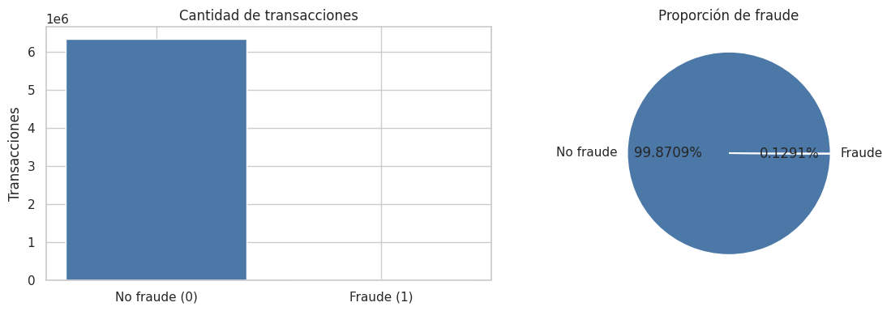
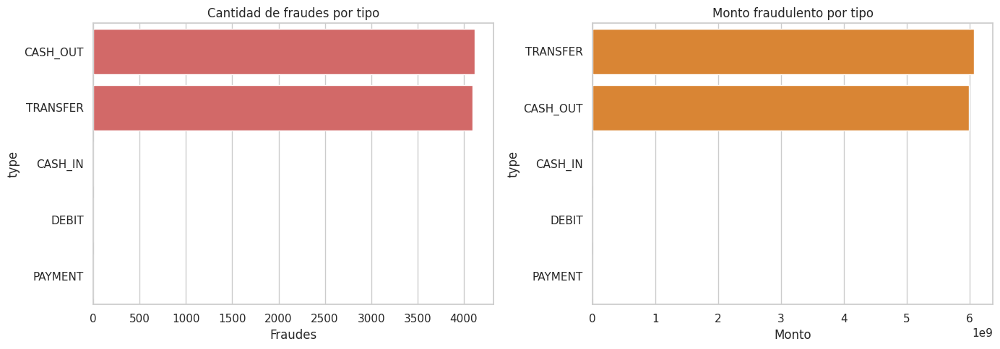
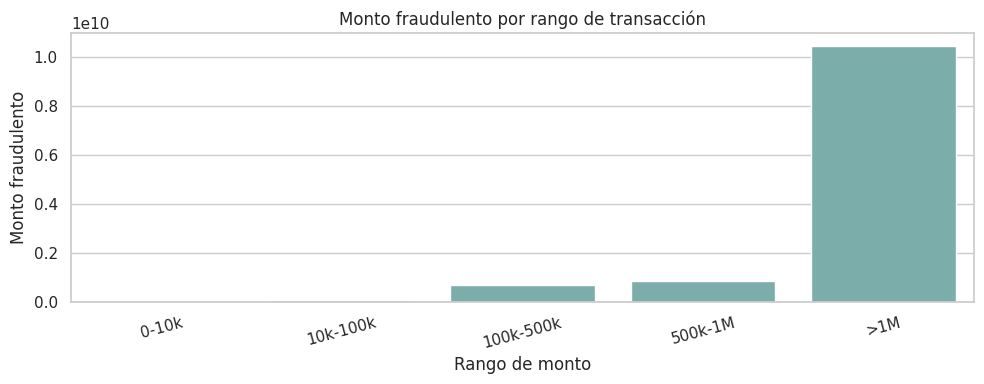
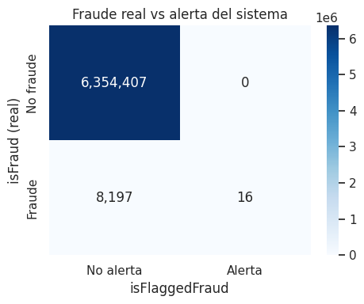
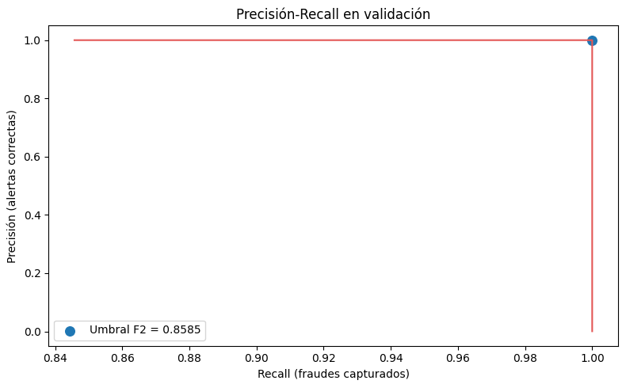
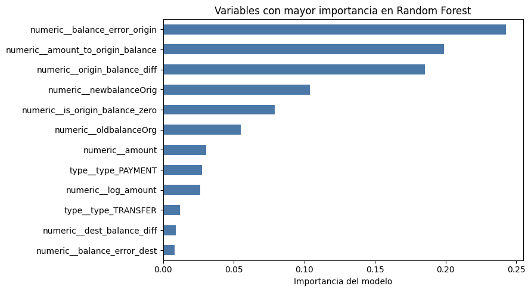
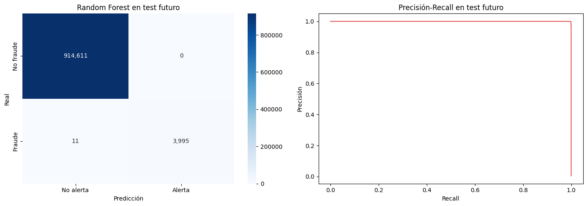
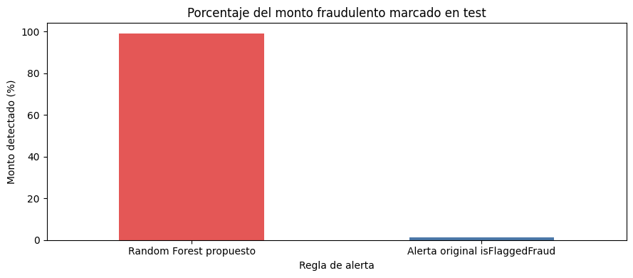

# Análisis de Fraude Financiero y Modelo Predictivo con PaySim

Proyecto de análisis de datos y modelado clasificativo para identificar transacciones fraudulentas en **PaySim**, un dataset sintético de operaciones financieras móviles.

El proyecto está desarrollado en notebooks explicados paso a paso, con una narrativa orientada a responder una pregunta de negocio:

> Si los fraudes son pocos, pero pueden representar pérdidas altas, ¿qué patrones permiten priorizar mejor las operaciones sospechosas?

## Resumen Del Proyecto

El trabajo se divide en dos partes:

| Parte | Objetivo | Entregables principales |
|---|---|---|
| 1. Entendimiento y análisis exploratorio | Medir el problema e identificar patrones de fraude | KPIs, gráficos, análisis por tipo, monto, saldos y alertas existentes |
| 2. Modelado predictivo | Construir y evaluar una alternativa de priorización | Ingeniería de variables, `RandomForestClassifier`, evaluación temporal y reporte final |

## Principales Resultados

### Análisis Exploratorio

Sobre las 6.362.620 transacciones del dataset:

| Hallazgo | Resultado |
|---|---:|
| Fraudes reales | 8.213 |
| Tasa de fraude | 0,13% |
| Participación del fraude en el monto total | 1,05% |
| Ticket promedio fraudulento vs. legítimo | Aproximadamente 8 veces mayor |

El fraude se concentra exclusivamente en dos tipos de operación:

| Tipo | Fraudes | Monto fraudulento | Tasa de fraude |
|---|---:|---:|---:|
| `TRANSFER` | 4.097 | 6.067.213.184,01 | 0,7688% |
| `CASH_OUT` | 4.116 | 5.989.202.243,83 | 0,1840% |

Otros resultados relevantes:

- Las operaciones mayores a 1.000.000 concentran aproximadamente **10.460 millones** en monto fraudulento.
- El **98,05%** de los fraudes deja el saldo de origen en cero, señal compatible con vaciamiento de cuenta.
- La alerta original `isFlaggedFraud` detecta solamente **16 de 8.213 fraudes** en el dataset completo.

Los detalles se encuentran en [reports/fraud_analytics_report.md](reports/fraud_analytics_report.md).

### Modelo Predictivo

El objetivo del modelo es predecir `isFraud`, por lo tanto se trata de un problema de **clasificación binaria**.

Se implementó un único modelo: **`RandomForestClassifier`**.

#### Por Qué Random Forest

La elección se basa en los patrones observados durante el análisis:

- Las variables incluyen montos, tipos de transacción y comportamientos de saldos.
- Es probable que las relaciones entre estas señales no sean lineales.
- El fraude es una clase minoritaria, y Random Forest permite ponderarla con `class_weight`.
- El modelo permite revisar importancias de variables para interpretar que señales utilizó.

Se consideraron conceptualmente alternativas como regresión logística, un árbol individual y gradient boosting, pero esta entrega busca construir y explicar correctamente **un solo modelo**, no realizar una competencia exhaustiva de algoritmos.

#### Evaluación Temporal

La columna `step` representa la hora simulada de cada transacción (`1 step = 1 hora`). Se utiliza solo para ordenar cronológicamente los datos y evitar fuga de información; **no se usa como variable predictora**.

| Conjunto | Regla temporal | Filas | Fraudes | Uso |
|---|---|---:|---:|---|
| Train | `step <= 323` | 4.463.587 | 3.643 | Entrenamiento |
| Validation | `324 <= step <= 378` | 980.416 | 564 | Selección del umbral |
| Test | `step > 378` | 918.617 | 4.006 | Evaluación final |

Para entrenar con recursos locales se conservaron todos los fraudes del conjunto de entrenamiento y se muestrearon operaciones legítimas solamente en `train`. Los conjuntos de validación y prueba se evaluaron completos.

#### Resultado En Test Futuro

El umbral de clasificación (`0,858498`) fue seleccionado exclusivamente en validación. En el conjunto de prueba futuro:

| Regla | Fraudes detectados | Recall | Precisión | F2 | Monto fraudulento priorizado |
|---|---:|---:|---:|---:|---:|
| Random Forest propuesto | 3.995 de 4.006 | 99,73% | 100,00% | 99,78% | 99,04% |
| `isFlaggedFraud` original | 13 de 4.006 | 0,32% | 100,00% | 0,41% | 1,12% |

El reporte completo se encuentra en [reports/model_evaluation_report.md](reports/model_evaluation_report.md).

## Visualizaciones Generadas

### Parte 1: Análisis Exploratorio

| Distribución del fraude | Fraude por tipo |
|---|---|
|  |  |

| Fraude por rango de monto | Alerta original vs. fraude real |
|---|---|
|  |  |

### Parte 2: Modelado

| Precisión-recall en validación | Importancia de variables |
|---|---|
|  |  |

| Evaluación temporal del modelo | Monto detectado |
|---|---|
|  |  |

## Recorrido De Notebooks

Los notebooks están escritos como una explicación progresiva del trabajo realizado:

| Orden | Notebook | Qué explica |
|---:|---|---|
| 1 | [`01_business_understanding.ipynb`](notebooks/01_business_understanding.ipynb) | Problema de negocio, preguntas y KPIs esperados |
| 2 | [`02_data_understanding.ipynb`](notebooks/02_data_understanding.ipynb) | Estructura del dataset, calidad básica y KPIs globales |
| 3 | [`04_exploratory_data_analysis.ipynb`](notebooks/04_exploratory_data_analysis.ipynb) | Patrones por tipo, monto, saldos y alertas existentes |
| 4 | [`03_data_cleaning_feature_engineering.ipynb`](notebooks/03_data_cleaning_feature_engineering.ipynb) | Variables del modelo, exclusiones y corte temporal |
| 5 | [`05_modeling.ipynb`](notebooks/05_modeling.ipynb) | Elección de Random Forest, entrenamiento y umbral |
| 6 | [`06_model_evaluation_interpretation.ipynb`](notebooks/06_model_evaluation_interpretation.ipynb) | Evaluación final, comparación e interpretación responsable |

La numeración conserva la estructura original del ejercicio; por eso el notebook `04` se ejecuta antes del `03` dentro del recorrido final.

## Variables Del Modelo

Se utilizaron variables originales y derivadas que tienen una interpretación clara:

| Grupo | Variables |
|---|---|
| Operación | `type`, `amount`, `log_amount` |
| Saldos originales | `oldbalanceOrg`, `newbalanceOrig`, `oldbalanceDest`, `newbalanceDest` |
| Señales derivadas | `origin_balance_diff`, `dest_balance_diff`, `balance_error_origin`, `balance_error_dest`, `amount_to_origin_balance`, `is_origin_balance_zero` |

Se excluyeron como entradas:

- `isFraud`, porque es la variable objetivo.
- `isFlaggedFraud`, porque se reserva para comparar el modelo contra la alerta existente.
- `nameOrig` y `nameDest`, porque son identificadores de cuentas y no reglas generalizables.
- `step`, porque se usa para separar periodos y no como atajo predictivo.

## Estructura Del Repositorio

```text
.
├── data/
│   ├── raw/                 # Ubicación esperada del CSV local, no versionado
│   ├── processed/           # Salidas derivadas locales, no versionadas
│   └── outputs/             # Metadatos generados localmente, no versionados
├── images/                  # Gráficos incluidos en el repositorio
├── models/                  # Modelo entrenado local, no versionado
├── notebooks/               # Desarrollo narrativo y ejecutable
├── reports/                 # Reportes finales incluidos
├── scripts/                 # Generadores de borradores de notebooks
├── src/modeling_utils.py    # Funciones reutilizables de modelado
├── tests/test_modeling_utils.py
├── requirements.txt
└── README.md
```

## Dataset

Este proyecto utiliza **PaySim**, dataset sintético de transacciones financieras móviles. Por tamaño y buenas prácticas de repositorio, el archivo CSV **no se incluye** en Git.

La fuente de descarga utilizada es [Synthetic Financial Datasets For Fraud Detection (PaySim) en Kaggle](https://www.kaggle.com/datasets/ealaxi/paysim1/data). El dataset fue generado con el simulador PaySim para experimentar con métodos de detección de fraude en operaciones de dinero móvil.

Para ejecutar el proyecto, ubica el CSV como:

```text
data/raw/paysim.csv
```

El archivo utilizado localmente tiene 6.362.620 registros y las columnas estándar de PaySim, incluyendo `type`, `amount`, saldos, `isFraud` e `isFlaggedFraud`.

## Instalación Y Ejecución

### 1. Crear Entorno

```bash
python -m venv .venv
source .venv/bin/activate
python -m pip install -r requirements.txt
```

En Windows:

```powershell
python -m venv .venv
.\.venv\Scripts\activate
python -m pip install -r requirements.txt
```

### 2. Agregar El Dataset

Coloca el archivo PaySim descargado localmente en:

```text
data/raw/paysim.csv
```

### 3. Ejecutar Los Notebooks

```bash
jupyter lab notebooks/
```

Ejecuta en este orden:

```text
01 -> 02 -> 04 -> 03 -> 05 -> 06
```

El entrenamiento de Parte 2 genera localmente:

- `models/random_forest_fraud.joblib`
- `data/processed/modeling_split_summary.csv`
- `data/outputs/model_metadata.json`

Estos artefactos están ignorados por Git y pueden regenerarse ejecutando los notebooks.

## Validación

Para comprobar las reglas reutilizables del modelado:

```bash
python -m unittest discover -s tests -v
```

Para ejecutar programáticamente la Parte 2:

```bash
python -m nbconvert --execute --to notebook --inplace notebooks/03_data_cleaning_feature_engineering.ipynb --ExecutePreprocessor.timeout=600
python -m nbconvert --execute --to notebook --inplace notebooks/05_modeling.ipynb --ExecutePreprocessor.timeout=600
python -m nbconvert --execute --to notebook --inplace notebooks/06_model_evaluation_interpretation.ipynb --ExecutePreprocessor.timeout=600
```

## Limitaciones Y Uso Responsable

- PaySim es un dataset sintético; las métricas no prueban rendimiento sobre operaciones bancarias reales.
- El modelo utiliza saldos posteriores a la transacción, por lo que representa priorización para revisión **post-transacción**, no bloqueo previo.
- El resultado elevado puede deberse a patrones simulados particularmente separables.
- Un sistema real requeriría validación externa, calibración de costos, monitoreo de deriva, control regulatorio y evaluación de impacto de falsas alertas.

## Conclusiones

El proyecto muestra que un problema de fraude no debe evaluarse solo por cantidad de casos: aunque el fraude es minoritario, concentra montos relevantes y patrones identificables. El análisis reveló concentración en `TRANSFER` y `CASH_OUT`, mayor exposición en operaciones de alto valor y una cobertura muy baja de la alerta original.

Como extensión del análisis, el Random Forest construido mejora ampliamente la priorización sobre el periodo temporal reservado de PaySim. Sin embargo, la conclusión correcta no es que exista un modelo listo para producción, sino que el flujo aplicado permite pasar de preguntas de negocio a una evaluación predictiva reproducible, interpretable y documentada con límites claros.

